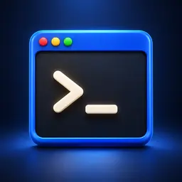

# Docker Terminal

Embedded multi-session terminal for Agent Zero, in chat and on the welcome screen.



This plugin adds a terminal button to the chat input area and opens a docked terminal panel directly inside the Agent Zero UI. It supports multiple PTY-backed sessions, tab switching, live resize, persistent sessions while hidden, and a configurable startup directory across both Docker and local development runtimes.

## Welcome panel

On a welcome screen with movable blocks, Terminal appears as a full-width panel. Click **Open terminal** to connect; visiting Welcome alone does not start a shell. Use the header controls to switch to half width, drag the panel, or dismiss it. **Show all dismissed** restores it. Adjacent half-width panels share a row; an unpaired panel expands automatically.

The welcome panel and chat panel share sessions and terminal controls. Moving the panel or switching between Welcome and chat preserves sessions, including when close-on-hide is enabled. Explicitly hiding the terminal still follows `preserve_sessions_on_hide`. On older Agent Zero versions, the original chat terminal remains available.

## Features

- Open a terminal panel directly from Welcome or the Agent Zero chat UI
- Automatically create the first session when the panel opens
- Run multiple terminal sessions with tab switching
- Copy selected terminal text and paste clipboard content from dedicated panel controls
- Resize the panel vertically from the UI
- Keep sessions alive while the panel is hidden, or close them on hide
- Configure startup directory, font size, cursor blink, and default panel height
- Resolve `/a0/...` startup directories correctly in both Docker and local development
- Works from `usr/plugins/docker_terminal` without any symlink or install script

Plugin settings are available under the `Developer` settings section.

## Usage

After the plugin is enabled:

1. Open Agent Zero in the browser.
2. Click the `Terminal` button near the chat input.
3. The panel opens and creates a session automatically if none exist yet.
4. Use the `+` tab button to create additional sessions.
5. Use the copy and paste buttons in the tab bar for clipboard operations (`Ctrl+Shift+C` and `Ctrl+Shift+V` are also supported).
6. Use the close button on a tab to close a session.
7. Collapse the panel with the arrow button when you want to hide it.

## Configuration

The plugin exposes the following settings:

- `startup_directory`: absolute native path or `/a0/...` path used for new sessions
- `preserve_sessions_on_hide`: keep sessions running when the panel is hidden
- `font_size`: terminal font size in pixels
- `cursor_blink`: enable or disable the blinking cursor
- `default_panel_height_vh`: initial panel height as viewport percentage

Default configuration:

```yaml
startup_directory: ""
preserve_sessions_on_hide: true
font_size: 14
cursor_blink: true
default_panel_height_vh: 40
```

## Notes

- The terminal runs inside the Agent Zero runtime environment, so it has access to the same filesystem and tools available to that runtime.
- In Docker, `/a0/...` paths are used directly. In local development, `/a0/...` paths are resolved to the matching local checkout path for execution while still being shown as `/a0/...` in the UI when applicable.
- Plugin installs, updates, and uninstall close plugin-owned terminal sessions. Installs and updates remove stale loaded plugin modules, and clean local bytecode caches so websocket reconnects can recover without an app restart.
- The frontend loads `xterm.js` and `xterm-addon-fit` from jsDelivr CDN at runtime.
- This plugin is designed for the Agent Zero plugin system and should live at the repository root when published as a standalone plugin repository.

## Verification

Run `node --test tests/welcome.test.mjs` for host handoff and loading cancellation checks. Live checks should include running a command, switching sessions, half/full width, reordering, dismissal/restoration, chat transitions, and both color themes.

## Repository Layout

```text
docker_terminal/
├── plugin.yaml
├── default_config.yaml
├── api/
├── extensions/
├── helpers/
└── webui/
```

## Import Pattern

Plugin-local Python imports should use the fully qualified `usr.plugins...`
package path:

```python
import usr.plugins.docker_terminal.helpers.session_store as session_store
from usr.plugins.docker_terminal.helpers.session_runtime import create_terminal_session
```

This avoids `sys.path` hacks, avoids persistent symlinks into `/a0/plugins/`,
and keeps plugin imports reversible: when the plugin is removed, no global
import wiring should remain behind.

## License

MIT
